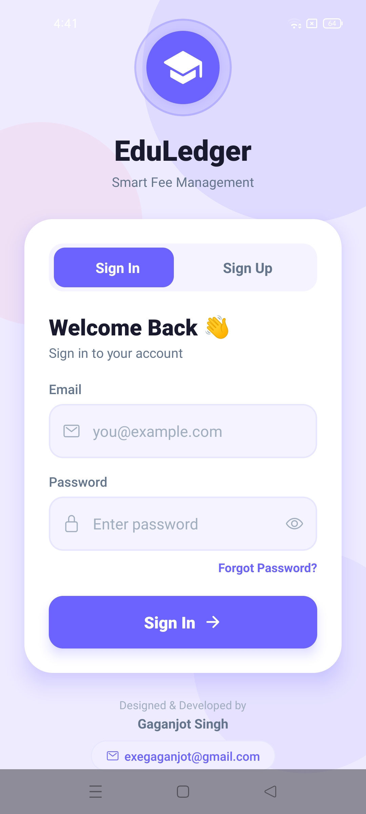
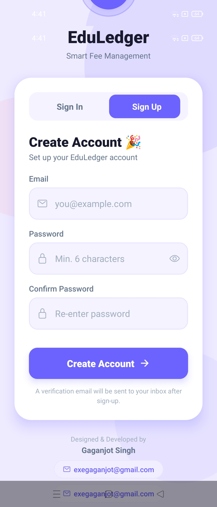
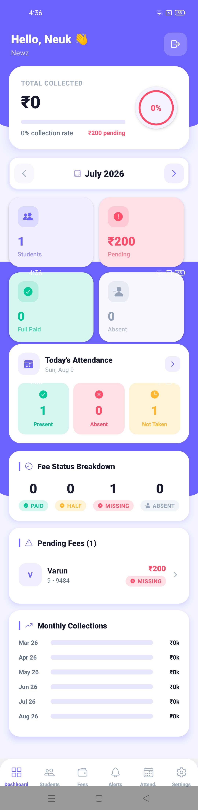
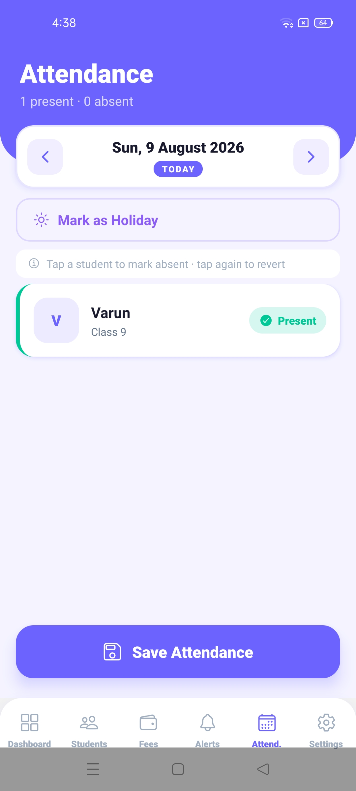
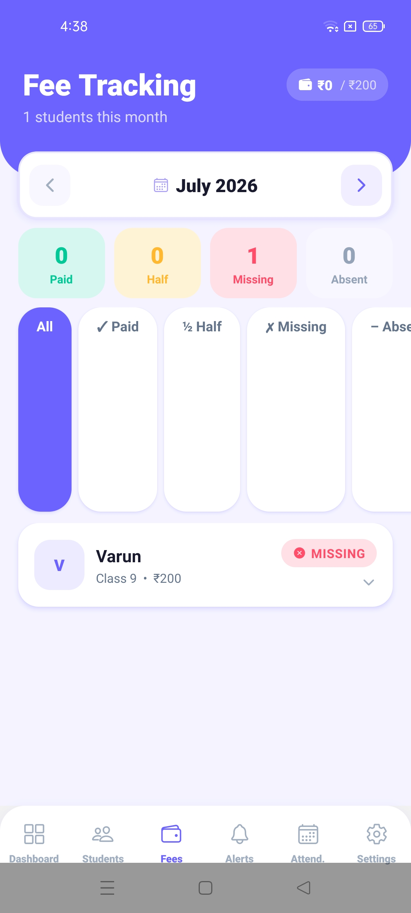
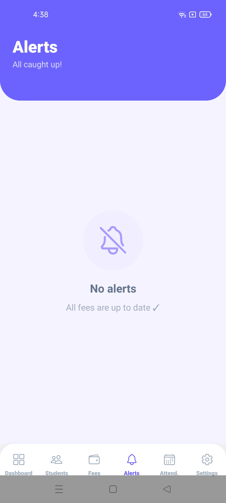
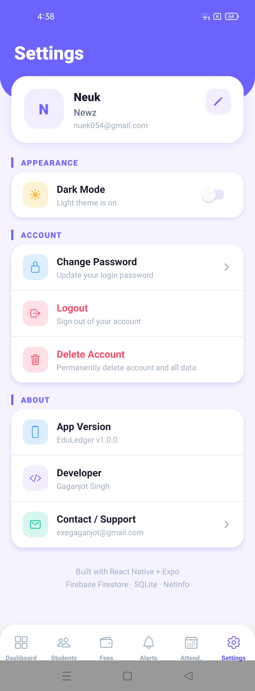
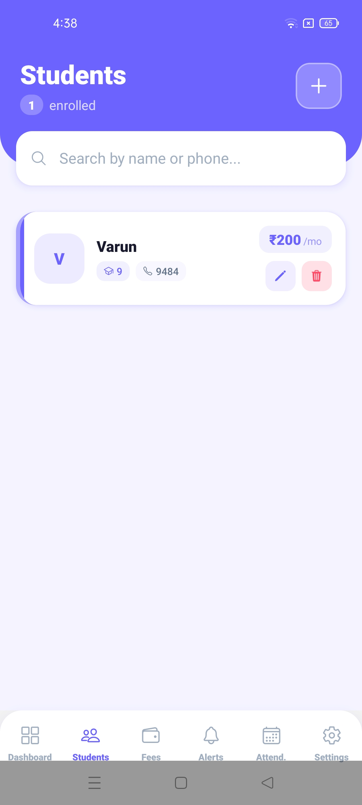

# 📚 EduLedger — Fee Management App


A mobile + backend solution for tuition centers and private teachers to manage student records, track monthly fees, take daily attendance, and get instant alerts for pending payments.

---

## ✨ Features
- 🔑 **Authentication**: Email/password signup, verification, forgot password, profile setup  
- 👨‍🎓 **Student Management**: Add, edit, delete students with search by name or phone  
- 💰 **Fee Tracking**: Auto-generated monthly records, mark Full / Half / Missing / Absent  
- 📅 **Daily Attendance**: Tap to mark absent, holiday toggle, auto-sync  
- 📊 **Dashboard**: Collection stats, today’s attendance card, 6‑month trend chart  
- 🔔 **Notifications**: Alerts for missing/partial fees, grouped Today / Earlier  
- 🌙 **Dark Mode**: Full theme toggle, persists across restarts  
- 📶 **Offline First**: Works without internet, syncs to Firebase Firestore when online  
- ☁️ **Cloud Backup**: Per-user Firestore sync, auto-restores on reinstall  

---

## 🛠 Tech Stack

| ⚙️ Layer | 🚀 Technology |
|----------|---------------|
| 📱 Mobile Framework |  |
| 🧭 Navigation |  |
| 💾 Local Database |  |
| ☁️ Cloud Backup |  |
| 🔐 Authentication |  |
| 🖥 Backend |  +  |
| 🛠 Build |  |

---

## 📂 Project Structure

EduLedger/
├── 📦 backend/ → Node.js + Express + MongoDB API
│   ├── 📂 controllers/ → auth, student, fee, dashboard, notification
│   ├── 📂 models/ → User, Student, FeeRecord, Notification
│   ├── 📂 routes/ → /api/auth, /api/students, /api/fees
│   ├── 🛡 middleware/auth.js → JWT protect middleware
│   └── ⚙️ server.js
└── 📱 mobile/ → React Native (Expo) app
├── 📂 app/ → Dashboard, Students, Fees, Alerts, Attendance, Settings
├── 💾 database/db.js → SQLite schema + CRUD
├── ☁️ services/firebase.js → Firestore sync + offline queue
├── 🎛 context/ → AuthContext, ThemeContext, MonthContext
└── 🖼 assets/ → App icon, splash screen

## 📸 Screenshots

| Login | Signup |
|-------|--------|
|  |  |

| Dashboard | Attendance |
|-----------|------------|
|  |  |

| Fees | Notifications | Settings | Student |
|------|---------------|----------|---------|
|  |  |  |  |


## 🚀 Getting Started

### Backend
```bash
cd backend
npm install
cp .env.example .env   # Fill in MONGO_URI and JWT_SECRET
npm run dev


cd mobile
npm install --legacy-peer-deps
cd android
./gradlew assembleRelease

APK output: android/app/build/outputs/apk/release/app-release.apk


🔧 Environment Variables
Create backend/.env from backend/.env.example:
PORT=5000
MONGO_URI=your_mongodb_connection_string
JWT_SECRET=your_jwt_secret
JWT_EXPIRES_IN=7d


Add your Firebase config file at:
mobile/android/app/google-services.json

App Info
App Name: EduLedger

Package: com.tuitionpro.app

Version: 1.0.0

Platform: Android (Min SDK 24, Target SDK 36)

Fee Month Range: July 2026 – July 2027

Attendance Range: August 2026 – August 2027


📜 License
MIT License — feel free to use, modify, and share with attribution.


This version is **GitHub‑ready**: badges, emojis, tables, and sections all render cleanly.  

👉 Do you want me to also add a **“Screenshots” section** with placeholders, so you can later drop in app screenshots to make the README visually appealing?
